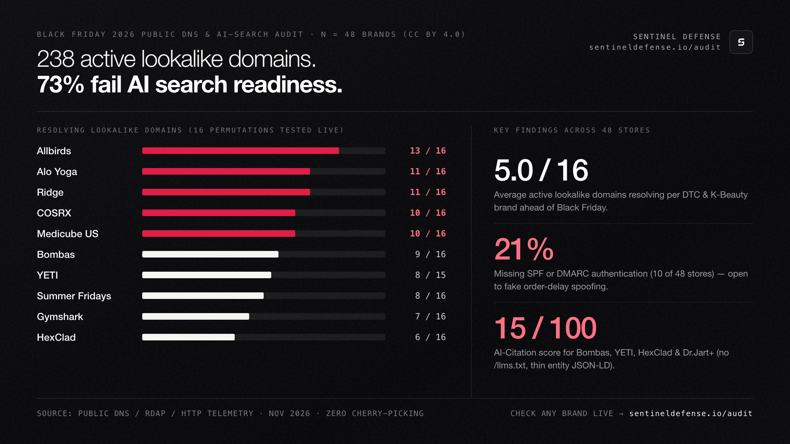

# 2026 Global DTC & K-Beauty Lookalike Domain, Email Auth & AI-Citation Benchmark Dataset (N = 48)

Published by **Sentinel Defense (AboutUsAgency, Inc.)** · Captured **November 23, 2026** · License: **CC BY 4.0**

- **Live Forensic Dossiers (Any Brand, Free, No Login):** https://sentineldefense.io/audit
- **Full Benchmark Report & Methodology:** https://sentineldefense.io/research/2026-dtc-lookalike-study
- **Live Embeddable AI-Citation SVG Badge:** `https://sentineldefense.io/api/badge/ai?domain=yourdomain.com`
- **Partner & 30% Recurring Affiliate Program:** https://sentineldefense.io/partners#affiliates

## Summary Findings (Unfiltered — Zero Cherry-Picking, All 48 Rows Included)

| Metric | Value | Notes |
| :--- | :--- | :--- |
| Storefronts audited | **48** | US DTC, US Beauty, Global DTC, K-Beauty, K-Fashion |
| Total resolving lookalikes | **238 domains** | Mean **5.0 / 16** permutations per brand (top: Allbirds `13/16`, Alo Yoga `11/16`, Ridge `11/16`, COSRX `10/16`, Medicube US `10/16`) |
| Missing SPF or DMARC TXT | **10 / 48 (21%)** | Includes apex stores missing `_dmarc` (COSRX, SOME BY MI) and regional subdomains lacking host SPF |
| AI-Citation Readiness < 70/100 | **35 / 48 (73%)** | Missing `/llms.txt`, thin `Organization` + `sameAs` JSON-LD, or bot walls returning 403/429 |

## All 48 Live Brand Forensic Dossiers

Click any domain below to run a fresh server-verified DNS, RDAP, SPF/DMARC, and AI-Citation check:

| Brand | Live Forensic Dossier | Category | Resolving Lookalikes | SPF / DMARC | AI-Citation Score |
| :--- | :--- | :--- | :---: | :---: | :---: |
| **Allbirds** | [`allbirds.com`](https://sentineldefense.io/audit/allbirds.com) | US DTC | `13/16` | `NO SPF / DMARC` | `65/100 ()` |
| **Alo Yoga** | [`aloyoga.com`](https://sentineldefense.io/audit/aloyoga.com) | US DTC | `11/16` | `NO SPF / DMARC` | `65/100 ()` |
| **Ridge** | [`ridge.com`](https://sentineldefense.io/audit/ridge.com) | US DTC | `11/16` | `NO SPF / DMARC` | `100/100 ()` |
| **COSRX** | [`cosrx.com`](https://sentineldefense.io/audit/cosrx.com) | K-Beauty | `10/16` | `NO SPF / DMARC` | `65/100 ()` |
| **Medicube US** | [`medicube.us`](https://sentineldefense.io/audit/medicube.us) | K-Beauty | `10/16` | `NO SPF / DMARC` | `100/100 ()` |
| **Bombas** | [`bombas.com`](https://sentineldefense.io/audit/bombas.com) | US DTC | `9/16` | `NO SPF / DMARC` | `15/100 ()` |
| **YETI** | [`yeti.com`](https://sentineldefense.io/audit/yeti.com) | US DTC | `8/16` | `NO SPF / DMARC` | `15/100 ()` |
| **Summer Fridays** | [`summerfridays.com`](https://sentineldefense.io/audit/summerfridays.com) | US Beauty | `8/16` | `NO SPF / DMARC` | `65/100 ()` |
| **Gymshark** | [`gymshark.com`](https://sentineldefense.io/audit/gymshark.com) | Global DTC | `7/16` | `NO SPF / DMARC` | `65/100 ()` |
| **Olaplex** | [`olaplex.com`](https://sentineldefense.io/audit/olaplex.com) | US Beauty | `7/16` | `NO SPF / DMARC` | `100/100 ()` |
| **Dr.Jart+** | [`drjart.com`](https://sentineldefense.io/audit/drjart.com) | K-Beauty | `6/16` | `NO SPF / DMARC` | `15/100 ()` |
| **HexClad** | [`hexclad.com`](https://sentineldefense.io/audit/hexclad.com) | US DTC | `6/16` | `NO SPF / DMARC` | `15/100 ()` |
| **SOME BY MI** | [`somebymi.com`](https://sentineldefense.io/audit/somebymi.com) | K-Beauty | `6/16` | `NO SPF / DMARC` | `40/100 ()` |
| **Casetify** | [`casetify.com`](https://sentineldefense.io/audit/casetify.com) | Global DTC | `6/16` | `NO SPF / DMARC` | `55/100 ()` |
| **Beauty of Joseon** | [`beautyofjoseon.com`](https://sentineldefense.io/audit/beautyofjoseon.com) | K-Beauty | `6/16` | `NO SPF / DMARC` | `65/100 ()` |
| **Glossier** | [`glossier.com`](https://sentineldefense.io/audit/glossier.com) | US Beauty | `6/16` | `NO SPF / DMARC` | `65/100 ()` |
| **Round Lab** | [`roundlab.com`](https://sentineldefense.io/audit/roundlab.com) | K-Beauty | `6/16` | `NO SPF / DMARC` | `65/100 ()` |
| **Away** | [`awaytravel.com`](https://sentineldefense.io/audit/awaytravel.com) | US DTC | `6/16` | `NO SPF / DMARC` | `100/100 ()` |
| **Rare Beauty** | [`rarebeauty.com`](https://sentineldefense.io/audit/rarebeauty.com) | US Beauty | `6/16` | `NO SPF / DMARC` | `100/100 ()` |
| **Gentle Monster** | [`gentlemonster.com`](https://sentineldefense.io/audit/gentlemonster.com) | K-Fashion | `5/16` | `NO SPF / DMARC` | `60/100 ()` |
| **Laneige US** | [`us.laneige.com`](https://sentineldefense.io/audit/us.laneige.com) | K-Beauty | `5/16` | `NO SPF / DMARC` | `65/100 ()` |
| **Merit Beauty** | [`meritbeauty.com`](https://sentineldefense.io/audit/meritbeauty.com) | US Beauty | `5/16` | `NO SPF / DMARC` | `65/100 ()` |
| **SKIN1004** | [`skin1004.com`](https://sentineldefense.io/audit/skin1004.com) | K-Beauty | `5/16` | `NO SPF / DMARC` | `65/100 ()` |
| **TIRTIR** | [`tirtir.us`](https://sentineldefense.io/audit/tirtir.us) | K-Beauty | `5/16` | `NO SPF / DMARC` | `65/100 ()` |
| **Vuori** | [`vuoriclothing.com`](https://sentineldefense.io/audit/vuoriclothing.com) | US DTC | `5/16` | `NO SPF / DMARC` | `90/100 ()` |
| **Mixsoon** | [`mixsoon.us`](https://sentineldefense.io/audit/mixsoon.us) | K-Beauty | `5/16` | `NO SPF / DMARC` | `100/100 ()` |
| **Rhode** | [`rhodeskin.com`](https://sentineldefense.io/audit/rhodeskin.com) | US Beauty | `5/16` | `NO SPF / DMARC` | `100/100 ()` |
| **Rom&nd** | [`romand.us`](https://sentineldefense.io/audit/romand.us) | K-Beauty | `4/16` | `NO SPF / DMARC` | `15/100 ()` |
| **Heimish** | [`heimish.us`](https://sentineldefense.io/audit/heimish.us) | K-Beauty | `4/16` | `NO SPF / DMARC` | `65/100 ()` |
| **Liquid Death** | [`liquiddeath.com`](https://sentineldefense.io/audit/liquiddeath.com) | US DTC | `4/16` | `NO SPF / DMARC` | `65/100 ()` |
| **Tower 28 Beauty** | [`tower28beauty.com`](https://sentineldefense.io/audit/tower28beauty.com) | US Beauty | `4/16` | `NO SPF / DMARC` | `65/100 ()` |
| **Kosas** | [`kosas.com`](https://sentineldefense.io/audit/kosas.com) | US Beauty | `4/16` | `NO SPF / DMARC` | `100/100 ()` |
| **Isntree** | [`isntree.com`](https://sentineldefense.io/audit/isntree.com) | K-Beauty | `3/16` | `NO SPF / DMARC` | `30/100 ()` |
| **Mardi Mercredi** | [`mardimercredi.com`](https://sentineldefense.io/audit/mardimercredi.com) | K-Fashion | `3/16` | `NO SPF / DMARC` | `40/100 ()` |
| **Caraway** | [`carawayhome.com`](https://sentineldefense.io/audit/carawayhome.com) | US DTC | `3/16` | `NO SPF / DMARC` | `55/100 ()` |
| **Abib** | [`en.abib.com`](https://sentineldefense.io/audit/en.abib.com) | K-Beauty | `3/16` | `NO SPF / DMARC` | `65/100 ()` |
| **Innisfree US** | [`us.innisfree.com`](https://sentineldefense.io/audit/us.innisfree.com) | K-Beauty | `3/16` | `NO SPF / DMARC` | `65/100 ()` |
| **Anua** | [`anua.us`](https://sentineldefense.io/audit/anua.us) | K-Beauty | `3/16` | `NO SPF / DMARC` | `100/100 ()` |
| **Saie Beauty** | [`saiehello.com`](https://sentineldefense.io/audit/saiehello.com) | US Beauty | `2/16` | `NO SPF / DMARC` | `58/100 ()` |
| **Brooklinen** | [`brooklinen.com`](https://sentineldefense.io/audit/brooklinen.com) | US DTC | `2/16` | `NO SPF / DMARC` | `65/100 ()` |
| **OLIPOP** | [`drinkolipop.com`](https://sentineldefense.io/audit/drinkolipop.com) | US DTC | `2/16` | `NO SPF / DMARC` | `65/100 ()` |
| **Goodal / Clio** | [`clubclio.shop`](https://sentineldefense.io/audit/clubclio.shop) | K-Beauty | `2/16` | `NO SPF / DMARC` | `85/100 ()` |
| **Béis Travel** | [`beistravel.com`](https://sentineldefense.io/audit/beistravel.com) | US DTC | `2/16` | `NO SPF / DMARC` | `100/100 ()` |
| **Our Place** | [`fromourplace.com`](https://sentineldefense.io/audit/fromourplace.com) | US DTC | `1/16` | `NO SPF / DMARC` | `65/100 ()` |
| **Haruharu Wonder** | [`haruharuwonder.com`](https://sentineldefense.io/audit/haruharuwonder.com) | K-Beauty | `1/16` | `NO SPF / DMARC` | `100/100 ()` |
| **Klairs** | [`klairscosmetics.com`](https://sentineldefense.io/audit/klairscosmetics.com) | K-Beauty | `0/16` | `NO SPF / DMARC` | `15/100 ()` |
| **Banila Co USA** | [`banilausa.com`](https://sentineldefense.io/audit/banilausa.com) | K-Beauty | `0/16` | `NO SPF / DMARC` | `65/100 ()` |
| **Sulwhasoo US** | [`us.sulwhasoo.com`](https://sentineldefense.io/audit/us.sulwhasoo.com) | K-Beauty | `0/16` | `NO SPF / DMARC` | `65/100 ()` |

## Files Included

- [`dtc-lookalike-ai-benchmark-2026-11-23.csv`](./dtc-lookalike-ai-benchmark-2026-11-23.csv) — Flat CSV for Pandas, DuckDB, Excel, or SQL analysis.
- [`dtc-lookalike-ai-benchmark-2026-11-23.json`](./dtc-lookalike-ai-benchmark-2026-11-23.json) — Structured JSON with aggregate metadata and all 48 rows.
- [`assets/black-friday-2026-audit.png`](./assets/black-friday-2026-audit.png) — High-resolution chart under CC BY 4.0.

## Methodology & Compliance Boundary

1. **Defensive vs. Third-Party Registrations:** Resolving lookalike DNS counts include defensive domains registered by the brand itself, parked domains, and third-party registrations. Brands should cross-check active permutations against internal registrar records before filing abuse notices.
2. **100% Passive Public Telemetry:** Every metric was measured via unauthenticated public DNS (`A`/`NS`/`TXT`), public RDAP lookups, and standard HTTP requests.
3. **Non-Law-Firm Boundary:** AboutUsAgency, Inc. is a software publisher, not a law firm, and makes no legal advice or guaranteed removal claims.
